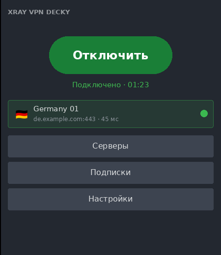

# Xray VPN Decky (xray-vpn-decky)

VPN client for Steam Deck: a [Decky Loader](https://github.com/SteamDeckHomebrew/decky-loader) plugin powered by [Xray-core](https://github.com/XTLS/Xray-core) with native TUN tunneling — works right in Gamemode (Quick Access Menu), no Desktop Mode needed. Supports **Happ/v2rayTUN subscriptions**, `vless://` links and full **Xray JSON configs**. No built-in links — bring your own subscription.



**Languages / Языки:** [English](#english) | [Русский](#русский)

---

<a id="русский"></a>
## Русский

### Возможности

- Подключение/отключение одной кнопкой из QAM, индикация состояния и длительности сессии
- Несколько подписок: добавление по URL или вставкой base64, обновление, переименование, удаление (с подтверждением)
- Список серверов: флаги, пинг (TCP), сортировка по пингу/названию, поиск, массовый пинг
- Автоподключение при старте Steam (к серверу с минимальным пингом), переподключение при смене сервера
- Автопереподключение при обрыве (до 3 попыток), восстановление после сна
- Ядро Xray уже включено в архив (linux-amd64, 26.11.9) — скачивание не требуется
- Логи для диагностики прямо в интерфейсе

### Установка

1. Скачайте архив `xray-vpn-decky.zip` из [релизов](https://github.com/sanrischannel-ui/xray-vpn-decky/releases) на Deck.
2. Включите **режим разработчика** в Decky Loader (Настройки Decky → Developer → включить Developer Mode), чтобы появилась установка из zip.
3. Установите плагин из zip-архива: Decky → Developer → «Install Plugin from ZIP» → выберите скачанный архив.
4. Загрузитесь в **Desktop Mode**.
5. Выполните в терминале (Konsole) команду, дающую бинарнику xray права на создание VPN-интерфейса:

   ```bash
   sudo setcap 'cap_net_admin,cap_net_bind_service,cap_net_raw=+eip' /home/deck/homebrew/plugins/xray-vpn-decky/bin/xray
   ```

6. Профит! Вернитесь в Gamemode, откройте Quick Access Menu (кнопка «…») → **Xray VPN Decky** → добавьте свою подписку → выберите сервер → Подключить.

> **Важно:** после обновления плагина бинарник xray заменяется, и права нужно выдать заново (повторить шаг 5).

### Права и безопасность

Бэкенд Decky работает не от root, поэтому команду из шага 5 выполнить обязательно. Никаких сторонних sudoers-правил не требуется — права привязаны к конкретному бинарнику.

### Лицензии

- Код плагина — [MIT](LICENSE)
- Включает [Xray-core](https://github.com/XTLS/Xray-core) (MPL-2.0)
- `geoip.dat` / `geosite.dat` — [Loyalsoldier/v2ray-rules-dat](https://github.com/Loyalsoldier/v2ray-rules-dat)

---

<a id="english"></a>
## English

### Features

- Connect/disconnect with a single button from the QAM, with session state and duration
- Multiple subscriptions: add by URL or pasted base64, update, rename, delete (with confirmation)
- Server list: country flags, TCP ping, sort by ping/name, search, ping-all
- Auto-connect on Steam start (to the lowest-ping server), reconnect on server change
- Auto-reconnect on drop (up to 3 attempts), recovery after sleep
- Xray core bundled in the archive (linux-amd64, 26.11.9) — no download required
- Diagnostic logs right in the UI

### Installation

1. Download `xray-vpn-decky.zip` from the [releases](https://github.com/sanrischannel-ui/xray-vpn-decky/releases) to your Deck.
2. Enable **Developer Mode** in Decky Loader (Decky Settings → Developer → enable Developer Mode) so that "Install from ZIP" becomes available.
3. Install the plugin from the zip: Decky → Developer → "Install Plugin from ZIP" → pick the downloaded archive.
4. Switch to **Desktop Mode**.
5. Run this command in a terminal (Konsole) — it grants the xray binary the privileges needed to create the VPN interface:

   ```bash
   sudo setcap 'cap_net_admin,cap_net_bind_service,cap_net_raw=+eip' /home/deck/homebrew/plugins/xray-vpn-decky/bin/xray
   ```

6. Profit! Go back to Gamemode, open the Quick Access Menu (the "…" button) → **Xray VPN Decky** → add your subscription → pick a server → Connect.

> **Note:** when you update the plugin, the xray binary is replaced and the privileges must be granted again (repeat step 5).

### Permissions and security

The Decky backend does not run as root, so step 5 is mandatory. No extra sudoers rules are needed — the privileges are attached to the specific binary.

### Licenses

- Plugin code — [MIT](LICENSE)
- Bundles [Xray-core](https://github.com/XTLS/Xray-core) (MPL-2.0)
- `geoip.dat` / `geosite.dat` — [Loyalsoldier/v2ray-rules-dat](https://github.com/Loyalsoldier/v2ray-rules-dat)

---

## Building from source

Requires Node.js 18+ (on the Steam Deck terminal or any PC):

```bash
npm install
npm run build
```

Output: `dist/index.js`.

---

## Участники / Contributors

- **WAYK-A** — автор проекта: идея, код, тестирование на Steam Deck
- **Kimi (Moonshot AI)** — архитектура плагина, бэкенд и фронтенд, отладка Xray-core TUN, парсинг подписок, решение проблем с правами (setcap/sudo), подготовка релиза

Полный список — в [CONTRIBUTORS.md](CONTRIBUTORS.md).
